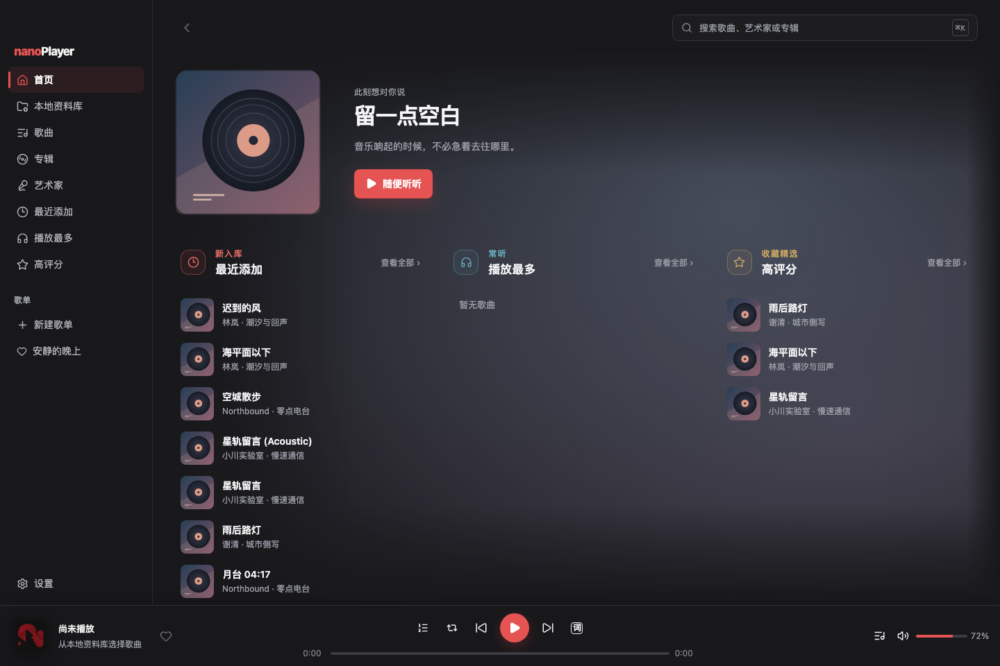
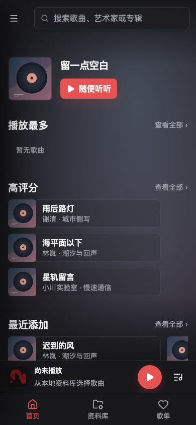
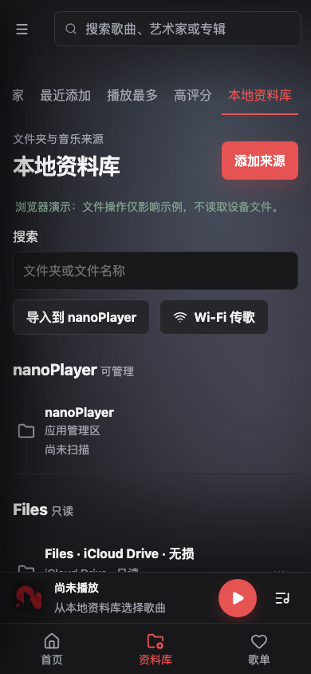
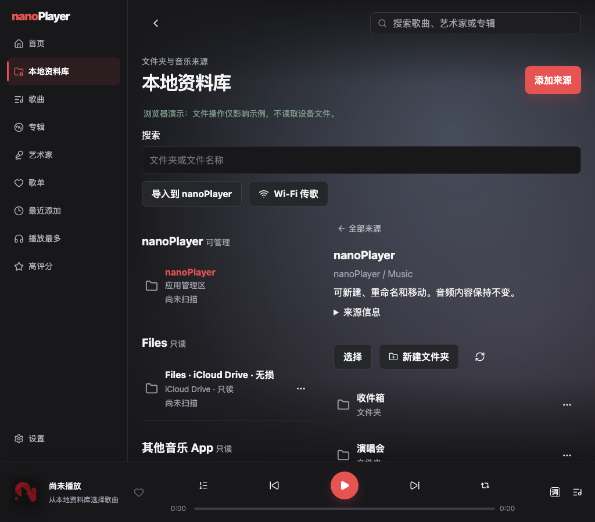

# nanoPlayer

[English](#english) · [中文](#中文)

[Website / 官网](https://nanoplayer-wei-feng.vercel.app) · [Downloads / 下载](https://nanoplayer-wei-feng.vercel.app/download)



Current shared UI captured from v0.1.23 source on 2026-10-15 with synthetic demo data in a browser. / 2026-10-15 基于 v0.1.23 源码拍摄的共享界面，使用浏览器演示数据，不代表原生设备验收。

## English

nanoPlayer is a local music player for desktop, Android, and iOS/iPadOS. Public downloads currently cover desktop; mobile clients remain local test builds. Add music folders, browse songs, albums and artists, and listen with playlists, ratings, a playback queue, lyrics and output-device selection. The home screen brings together recently added, most-played and highly rated songs.

- Local playback with no account required
- External source audio stays read-only; iOS can organize copied files inside its own Documents/Music library
- Local SQLite library for indexes, playlists, ratings, and listening history
- MP3, FLAC, M4A/AAC, ALAC, WAV, Ogg Vorbis, Opus, and AIFF support
- Desktop downloads are available for macOS universal, Windows x64, and Linux x64
- Current packages are unsigned; macOS packages are not Apple-notarized

## 中文

nanoPlayer 是一款面向桌面、Android 与 iOS/iPadOS 的本地音乐播放器。桌面版已开放下载，移动客户端目前仍为本地测试构建。添加音乐文件夹后，可以按歌曲、专辑和艺术家浏览收藏，使用歌单、评分、播放队列、歌词和输出设备切换。首页集中展示最近添加、播放最多和高评分歌曲。

- 本地播放，无需账号
- 外部源音频只读；iOS 可整理复制到应用 Documents/Music 管理区中的文件
- 使用本机 SQLite 保存索引、歌单、评分与收听记录
- 支持 MP3、FLAC、M4A/AAC、ALAC、WAV、Ogg Vorbis、Opus 和 AIFF
- 已提供 macOS 通用版、Windows x64 和 Linux x64 桌面安装包
- 当前安装包未签名，macOS 版尚未完成 Apple 公证

## Project status / 项目状态

Updated / 更新：2026-10-15 · Source / 源码：v0.1.23 · [Published desktop / 桌面发布](https://github.com/maweifeng2024/nanoPlayer/releases/tag/v0.1.23)

| Client / 客户端 | Implemented / 已实现 | Distribution and acceptance / 分发与验收 |
| --- | --- | --- |
| Desktop | Local folders, playlists, ratings, search, queue, output selection, synchronized/word-timed lyrics and per-song offset / 本地目录、歌单、评分、搜索、队列、输出切换、同步及逐字歌词与偏移 | macOS universal, Windows x64, Linux x64 downloads; unsigned / 已公开下载，未签名 |
| Android phone / Pad | Shared responsive UI, SAF libraries, native playback/queue, background session and sleep timer / 响应式界面、SAF 资料库、原生播放队列、后台会话与定时停止 | Local debug APK; v0.1.23 not installed in this verification, long-duration/device acceptance remains / 本地调试 APK，当前版本真机及长时验收待完成 |
| iPhone / iPad | AVPlayer, Files read-only references, managed library folders/moves, foreground Wi-Fi import / 原生播放、Files 只读引用、自有资料库文件夹与移动、前台 Wi-Fi 导入 | Development-signed IPA; simulator navigation/file-management checks passed; real Files/provider, uploads and background audio remain to qualify; no TestFlight / 开发签名 IPA，模拟器导航与文件夹操作已验证，真实文件来源、上传及后台待验收，未上架 |

iOS library sources are grouped into nanoPlayer, Files, and other music apps that expose accessible folders. App-private and DRM caches are not accessed. Online lyrics remain opt-in; word highlighting requires actual word timestamps.

iOS 资料库按 nanoPlayer、Files、其他音乐 App 分区；其他 App 须公开可访问文件夹，不读取私有或 DRM 缓存。在线歌词默认关闭；逐字高亮依赖实际逐字时间轴。

See the [client matrix](docs/clients/README.md), [desktop status](docs/clients/desktop/STATUS.md), [Android status](docs/clients/android/STATUS.md), [iOS status](docs/clients/ios/STATUS.md), and [product plan](docs/product/PRODUCT_AND_TECHNICAL_PLAN.md) for verification boundaries.

### Current screenshots / 当前截图

Captured on 2026-10-15 from shared UI using browser demo data; these are interface previews, not native playback evidence.

2026-10-15 拍摄，使用共享界面的浏览器演示数据；仅展示界面，不作为原生播放验收证据。

| Android phone | iPhone |
| --- | --- |
|  |  |



Repository and documentation boundaries are described in [Project Structure](docs/PROJECT_STRUCTURE.md). Dated audits and superseded plans are retained under [docs/archive](docs/archive/README.md) and are not current status sources.

## Development / 开发

### Prerequisites

- Node.js 22+
- pnpm 11+
- Stable Rust with `rustfmt` and `clippy`
- Tauri 2 platform prerequisites for the target operating system

### Start developing

```bash
pnpm install
pnpm tauri dev
```

Run `pnpm check` for frontend lint, unit tests, type checking, and a production UI build. Run `pnpm test:e2e` for browser flows and `cargo test --manifest-path src-tauri/Cargo.toml` for the Rust core. Build a local macOS app with `pnpm tauri build --debug --bundles app`. The website is independent: `npm --prefix website run dev`.

## Safety boundary / 安全边界

External music directories are read-only inputs. iOS file organization is restricted to its app-owned Documents/Music directory. Ratings, playlists, listening history, downloaded lyrics, artwork thumbnails, and recovery state belong in application-managed storage.

外部音乐目录仅作为只读输入。iOS 文件整理仅限应用自己的 Documents/Music 管理区。评分、歌单、收听记录、下载歌词、封面缩略图与恢复状态均保存在应用管理的数据目录中。
