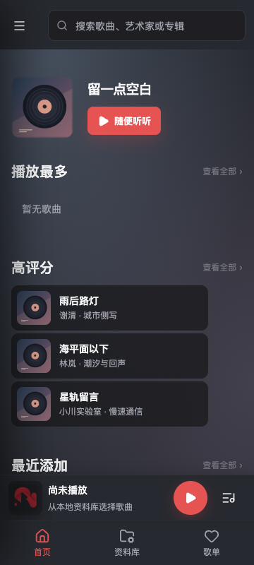
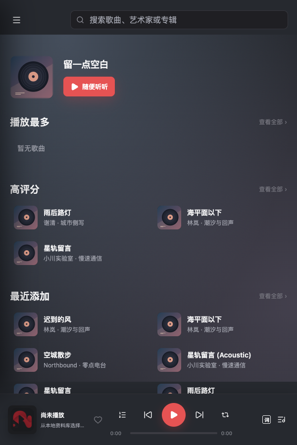
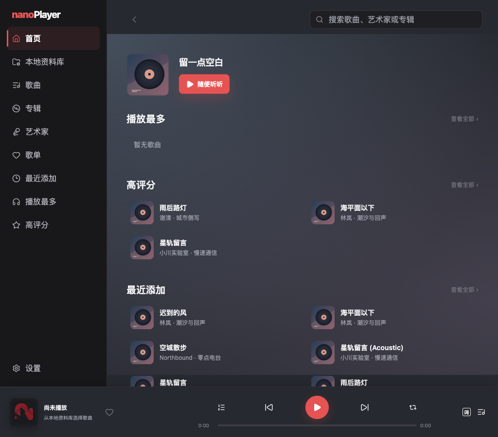

# iPhone / iPad 设计提案

2026-10-14。用户已确认 Android 设计继承、默认复制加只读引用、iOS/iPadOS 16 起步，以及浏览器上传加配对码的 Wi-Fi 传歌。设备和账号信息尚待提供；实现证据见 [状态](STATUS.md)。

新增三类资源、目标文件夹保存与移动需求已获用户确认，见 [资源库设计](LIBRARY_DESIGN.md)。0.1.23 接入来源与管理区文件操作；外部默认只读，具体设备证据与未验收项以状态文档为准。

## 继承 Android

复用共享 React UI、主题 token、图标、歌曲/专辑/艺术家/歌单/收藏/统计/歌词功能、菜单顺序、筛选规则及队列语义。默认深色、珊瑚红强调色；主题文案保留“系统、浅色、深色”。首页沿用现有封面与 16% 底色、无模糊方案。保留真实逐字歌词、字号与偏移、评分和本地优先规则。在线歌词仍明确 opt-in。

以下是布局继承参考，来自仓库 Android 设计基线；不是 iOS 实机截图，现有最新功能以共享实现和设计规范为准。

| iPhone 布局基线 | iPad 窄分屏基线 | iPad 宽屏基线 |
| --- | --- | --- |
|  |  |  |

## iPhone

- 延续 Android 手机导航、首页、搜索与资料库层级，底部导航和 mini player 各自独立，预留 Home Indicator 安全区。
- 点击 mini player 打开全屏播放页：封面、标题/艺术家、进度、播放控制、队列、歌词；关闭回到原页面和滚动位置。
- 系统返回手势按“弹层 → 播放页 → 详情 → 原页面”关闭，滑动进度和横向内容不误触发返回。
- 更多按钮再次点击关闭；长按打开同一菜单，滚动取消长按。触控目标至少 44pt，适配大字体、VoiceOver 和减少动态效果。
- 不依赖硬件返回键；系统音量/音频路由使用 Apple 音频面板。

## iPad

- 宽屏：侧栏、独立滚动内容、固定播放器；歌词/队列使用右侧抽屉，保持现有功能入口顺序。
- 600–900 CSS px 的窄布局：72px 图标侧栏并保留可访问名称；不因分屏改为手机导航。
- 更窄的窗口：提供可关闭的导航覆盖层，保留 iPad 菜单结构。按窗口可用宽度与设备类别设计，不用屏幕物理尺寸猜测。
- 验证竖屏、横屏、分屏和窗口缩放；系统安全区与键盘不能遮挡播放器或弹层。

## Apple 原生适配

建议 Swift 原生层承担文件授权、播放队列、AVAudioSession、锁屏/控制中心与系统音频路由。React 不作为后台播放、计数或睡眠定时器的唯一运行位置。Rust 复用数据库、元数据与领域规则，桌面 rodio、updater、文件监听与窗口初始化必须隔离。

建议文件导入默认复制到应用资料库，保持源文件只读；可选文件夹引用以 security-scoped bookmark 管理授权。云端未下载、授权失效、移动/删除、空间不足必须有可恢复状态。引用模式能否稳定后台读取须先用真实 Files provider 验证；不能提前承诺与 Android SAF 完全等价。

首轮优先打通“合成音频导入 → 扫描 → 播放 → 后台/锁屏 → 重启恢复”，再接入完整共享功能。格式支持按真机解码矩阵报告，不把 Android 支持格式直接视为 iOS 支持格式。

## 已确认与待提供信息

1. 已批准 Android 风格与布局继承，仅做 Apple 必需适配。
2. 已批准默认复制加可选只读引用。选择器支持音乐文件/文件夹复制导入；只读引用入口单独选择文件夹。
3. 采用 iOS/iPadOS 16 起步，先模拟器与真机开发签名验证，再 TestFlight。最低版本运行仍须验证；目标设备和账号待用户提供。

本地 Bundle ID 已设为 `app.nanoplayer.ios`，Apple Developer 注册可用性尚未确认；不复用桌面 Bundle ID。云同步、Apple Music 订阅内容和 CarPlay 不属于本次首轮功能范围。

## Wi-Fi 传歌（已确认）

- 显式开启前台接收页，显示地址、地址二维码和本次八位配对码；二维码不包含配对码。
- 同一 Wi-Fi 的设备通过浏览器批量上传，流式接收，单个最大 512MB。
- 存入应用管理目录，不覆盖旧文件；完整上传后才入库。
- 切到后台、关闭页或点击停止会关闭服务；再次启动更换配对码。
- 明示本地 HTTP 不加密，要求可信 Wi-Fi；拒绝路径穿越、非音频扩展名、超限和未配对请求。
- 实际网络、权限拒绝/恢复、空间不足、大文件与中断清理仍待原生设备验收。
